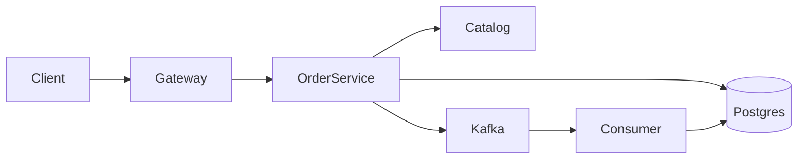

# spanlab

One order, followed from an HTTP call through Postgres, Kafka, and a Go consumer, with the trace still connected after the response has returned.

The gateway on port **8080** is the only API. It forwards to a Java order service, which checks the SKU with a catalog service over gRPC, then commits the order and an outbox row in one transaction. A timer publishes that row to Kafka. The consumer writes a projection and ignores a duplicate event. Jaeger shows the whole path as one trace. Grafana shows how often the Java services are called.



## Run it

Docker is enough. Java and Go are built inside the images.

```powershell
docker compose up --build -d
```

| URL | What it is |
| --- | --- |
| http://localhost:8080/healthz | Gateway. Create orders here. |
| http://localhost:16686 | Jaeger. One trace per order. |
| http://localhost:3000/d/spanlab/spanlab | Grafana. Request rates. Sign-in password `spanlab`. |

```powershell
curl.exe -sS -D - --data-raw '{"customerId":"cust-1001","sku":"SKU-1","quantity":2,"amount":"19.99"}' -H "Content-Type: application/json" http://localhost:8080/api/v1/orders
```

`SKU-1` and `SKU-2` are known. Any other SKU is `400`. The full walk-through is [Use the lab](learning/03-use-the-lab.md). A new machine starts at [Set up a new machine](learning/02-new-machine.md).

Ten more orders:

```powershell
docker compose --profile load run --rm loadgen
```

## Learn the code

Written for a Java developer who is new to Go.

1. [Start here](learning/00-start-here.md) — Java-to-Go cheat sheet for this repo
2. [One order](learning/01-one-order.md) — the create path, an unknown SKU, and a poison payload
3. Concepts: [Kafka](learning/concepts/kafka.md), [outbox](learning/concepts/postgres-and-outbox.md), [tracing](learning/concepts/tracing.md), [gRPC](learning/concepts/grpc.md), [Grafana](learning/concepts/metrics.md), [Compose and Kubernetes](learning/concepts/compose-and-kubernetes.md)
4. Services: [gateway](learning/services/gateway.md), [order service](learning/services/order-service.md), [catalog](learning/services/catalog-service.md), [consumer](learning/services/consumer.md), [load generator](learning/services/loadgen.md)

## Layout

| Path | What it is |
| --- | --- |
| `gateway/` | Go HTTP entry on port 8080 |
| `order-service/` | Spring Boot 4.1.2. Outbox and publisher. Port 8081 inside the network |
| `catalog-service/` | gRPC `CheckSku` on port 9090. HTTP health on 8083 |
| `consumer/` | Go reader for `order-events`. Projection API on port 8082 |
| `loadgen/` | Posts orders. Runs only with the Compose `load` profile |
| `proto/` | Shared catalog contract |
| `ops/` | Prometheus, Grafana, and the Bash health check |
| `k8s/spanlab.yaml` | The same stack as manifests. Not applied by Compose |
| `docs/` | The build contract: behavior, schema, and the tracker |
| `learning/` | The reading guide |

`amount` is `numeric(12,2)` in Postgres and a decimal string in JSON. A bad Kafka payload goes to `order-events-dlq` so the consumer can keep moving.
