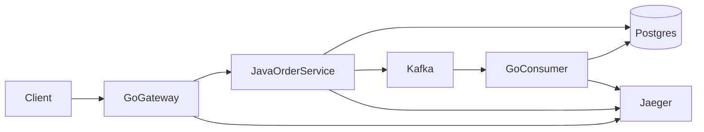

# What spanlab does

`spanlab` is a study lab. You create one order and follow it across three processes, a database, and a log of events. The thing to learn is the path: a synchronous write, a reliable event, and a single trace that stays connected after the HTTP call has already returned. To read the code, start at [learning/00-start-here.md](../learning/00-start-here.md).

CollabFlow is a separate project. This repo is the lab.

## The pieces

| Piece | Role |
| --- | --- |
| Go gateway | The only HTTP entry from your machine. Starts the trace and calls the other two processes. |
| Java order service | Spring Boot 4.1.2. Stores the order and an outbox row in one database transaction, then publishes the event. |
| Postgres | System of record for the order, the outbox, and the consumer's projection. |
| Kafka | The event log. Topics `order-events` and `order-events-dlq`. |
| Go consumer | Reads `order.created` and writes a projection row. A repeated event does not create a second row. |
| Jaeger | Shows the trace. |

The gateway talks to Java over HTTP. The trace crosses that call as a W3C `traceparent` header. The same header is stored on the outbox row, and the publisher puts the child context on the Kafka record. Before that transaction, the order service asks the catalog over gRPC whether the SKU is known. A payload the consumer cannot apply goes to `order-events-dlq`.

## One order

```mermaid
sequenceDiagram
  participant Client
  participant Gateway as GoGateway
  participant Order as JavaOrderService
  participant DB as Postgres
  participant Kafka
  participant Consumer as GoConsumer

  Client->>Gateway: POST /api/v1/orders
  Gateway->>Order: POST /api/v1/orders plus traceparent
  Order->>DB: insert order and outbox row, one commit
  Order-->>Gateway: 201 Created
  Gateway-->>Client: 201 Created
  Note over Order,Kafka: later, on a schedule
  Order->>DB: lock unpublished outbox rows
  Order->>Kafka: order.created with trace headers
  Order->>DB: mark the row published
  Kafka->>Consumer: deliver the record
  Consumer->>DB: insert projection, ignore a duplicate event id
```

1. The gateway accepts `POST /api/v1/orders`, starts a span, and calls the Java service with `traceparent`.
2. Java inserts the order and the outbox row in one database transaction, and stores `traceparent` on that row. The HTTP call finishes here. The client has an order id even though no consumer has run.
3. A publisher in the same Java process later locks unpublished rows with `FOR UPDATE SKIP LOCKED`, restores that trace, and sends `order.created` to Kafka with the trace headers. Then it marks the row published.
4. The Go consumer continues the same trace, writes one projection row, and ignores a duplicate event id.

Two reads confirm the path:

- `GET /api/v1/orders/{id}` reads the order from Java. It succeeds as soon as the create transaction commits.
- `GET /api/v1/projections/{orderId}` reads the consumer's row. It succeeds after Kafka delivery, which can be about a second later.

## Why the trace is stored on the outbox row

The publisher runs on a timer, after the request thread is gone. A span that starts inside that timer would be a new trace.

The create transaction copies `traceparent` and `tracestate` onto the outbox row. When the publisher wakes up, it rebuilds the parent context from those columns and starts `outbox.publish` as a child. Kafka record headers carry the same context, and the consumer's `order.created` span is a child of the publish span.

In Jaeger that is one trace: gateway, Java create, outbox publish, consumer.

## What "delivered" means

Delivery is at-least-once.

The order and the outbox row commit together. A crash before that commit leaves neither. After the commit, the publisher will keep trying until Kafka accepts the record and the row is marked `PUBLISHED`.

A crash in the gap after Kafka accepts the record and before the row is marked `PUBLISHED` sends the event again. The projection table uses the event id as its primary key, so the second delivery does not add a second row.

That is the guarantee of this lab. It is a reliable event with a visible duplicate, handled on purpose by the consumer.
