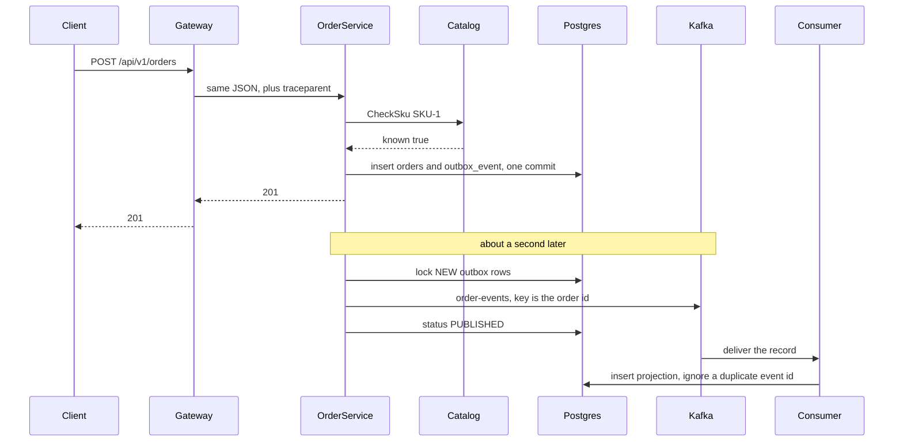

# One order

This is the path a single create takes. Read it once, then open the service doc for the box you want to study.

## The happy path, `SKU-1`

1. Your HTTP client calls the gateway on port 8080. [gateway/main.go](../gateway/main.go) starts a server span named `POST /api/v1/orders` and forwards the body to `http://order-service:8081`. The client timeout is 2 seconds. The gateway copies the downstream status and body back to you.
2. [OrderController.java](../order-service/src/main/java/com/spanlab/order/OrderController.java) reads the JSON and the `traceparent` / `tracestate` headers.
3. [OrderService.java](../order-service/src/main/java/com/spanlab/order/OrderService.java) checks the fields, then [CatalogLookup.java](../order-service/src/main/java/com/spanlab/order/CatalogLookup.java) calls `CheckSku` on the catalog. `SKU-1` and `SKU-2` are known. This call finishes before any database transaction opens.
4. `OrderWriter.insert` is `@Transactional`. It inserts `"order".orders` and `"order".outbox_event` in that one transaction. The outbox row is status `NEW` and stores the incoming `traceparent`. The HTTP response is `201` only after that commit. Kafka has not been called yet.
5. [OutboxPublisher.java](../order-service/src/main/java/com/spanlab/order/OutboxPublisher.java) wakes every second. It locks up to 20 `NEW` rows with `FOR UPDATE SKIP LOCKED`, starts span `outbox.publish` from the stored trace, sends the record to topic `order-events`, then sets the row to `PUBLISHED`.
6. [consumer/main.go](../consumer/main.go) is in group `spanlab-projection`. It starts span `order.created` from the Kafka headers, inserts `projection.processed_orders`, and commits the Kafka offset only after the insert returns. A second delivery of the same event id changes nothing, because of `ON CONFLICT (event_id) DO NOTHING`.

Two reads:

- `GET /api/v1/orders/{id}` works as soon as step 4 commits. The gateway forwards it to the order service.
- `GET /api/v1/projections/{orderId}` works after step 6. The gateway forwards it to the consumer on port 8082. That can be about a second later.

Open Jaeger at http://localhost:16686 and search service `gateway`. One trace contains the gateway server span, the gateway client span, the order-service HTTP span, `outbox.publish`, and `order.created`. `order.created` is a child of `outbox.publish`. The header stored on the outbox row is the incoming request header. The header on the Kafka record is the child context from `outbox.publish`. [Tracing](concepts/tracing.md) explains why those two strings differ.

## Unknown SKU

`SKU-9` never reaches Postgres. `CatalogLookup` gets `known: false`, and the order service returns `400` with detail `sku is unknown`. The gateway forwards that status. There is no outbox row and no Kafka record.

If the catalog process is down, the gRPC call throws `StatusRuntimeException` and the order service returns `503`.

## A payload the consumer cannot apply

A record whose value is not the JSON envelope, such as the bytes `not-json`, is a permanent failure. The consumer publishes that value to `order-events-dlq`, commits the offset on `order-events`, and keeps reading the next record.

A database error is different. The consumer republishes the same value to `order-events` with header `x-attempts`. After three tries it uses the dead-letter topic and then commits. [Kafka](concepts/kafka.md) walks through both cases.

## What you can watch

- Jaeger, port 16686: the trace for one order.
- Grafana, http://localhost:3000/d/spanlab/spanlab : HTTP request rate for `order-service` and `catalog-service`.
- The load generator posts ten `SKU-1` orders when you run `docker compose --profile load run --rm loadgen`. It is not part of `docker compose up`.
